# Genie: System Design

Reads the code as of 2026-10-12 (branch `feature/e2e`, uncommitted work included).

> **Update 2026-10-17:** the user service was split. `property` (listings, search), `chat`, `payment` and `user`
> (profile) now run as separate services; where this document says "User service", read the service for that
> feature. The current layout, the calls between services and the deployment are in `README.md` and
> `docs/RAILWAY.md`. The diagrams below are otherwise still accurate for what each feature does.
Diagrams are Mermaid: they render on GitHub and in VS Code with the "Markdown Preview Mermaid Support" extension.
Step numbers in each diagram match the numbered list under it, like the like-service picture.

Legend: solid arrow = request, dashed arrow = background or asynchronous, `[(...)]` = storage.

Rule: the app reaches the backend only through the API Gateway. The only direct connections are signed URLs to Supabase Storage (uploads and downloads) and third-party services.

---

## 0. The whole system

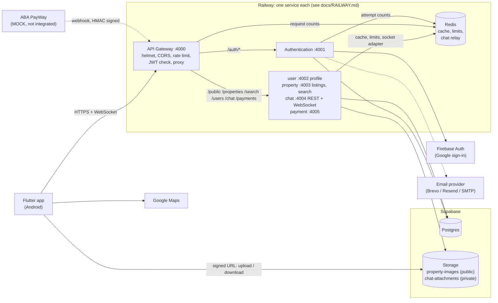

| Piece | What it does | Notes |
|---|---|---|
| API Gateway | Only public entry. Verifies access JWT (RS256, `typ=access`), writes `x-user-id`, proxies | 300 req/min per IP, counted in Redis |
| Authentication | Register, login, Google login, refresh, logout, password reset | Talks to Postgres through the Supabase client |
| User service | Everything else | Talks to Postgres through Prisma |
| Notification service | Push devices, notification preferences, promotions; sends chat, sign-in, call and promotion pushes through Firebase Cloud Messaging | Section 14b. Called by chat and authentication over `/internal` |
| Redis | Cache (map, listing page, chat keys, public profile), all rate limits, chat events between instances, live calls | Never the only copy: everything falls back to the database or memory. Inside the container today; must be external before a second instance |
| Supabase Postgres | All data | One database, shared by local dev and production |
| Supabase Storage | Property photos (public bucket), chat files (private bucket) | Clients upload and download directly with signed URLs |

Trust model: the internal services believe the `x-user-id` header. They must never be reachable except through the gateway (true on Railway: only port 4000 is published).

---

## 1. Register and log in (email or phone)

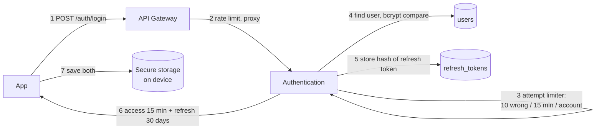

1. App posts email or phone plus password.
2. Gateway counts the request for the client IP and forwards it (no JWT needed on `/auth`).
3. Per-account counter: 10 wrong passwords pauses that account for 15 minutes. A correct login clears it.
4. Same error for unknown user and wrong password (no account probing). bcrypt, 10 rounds.
5. A refresh token row is stored with only a SHA-256 hash (`sha256:...`) and a `jti`. The token is a signed JWT with a random id, so a fast hash is as safe as bcrypt, which cost ~0.1 s per refresh and only read its first 72 bytes. Rows from before carry a bcrypt hash until their next refresh (at most 30 days).
6. Two RS256 JWTs come back: access (15 min, `typ=access`) and refresh (30 days, `typ=refresh`).
7. App keeps them in `flutter_secure_storage`.

**Register** is the same path with `POST /auth/register`: password at least 8 characters, role always `user`, email and phone are **not verified**.

## 2. Session: every API call, refresh, logout

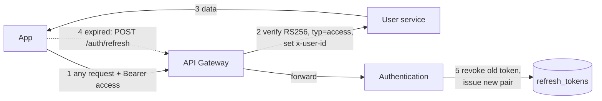

- 2: the gateway rejects missing, expired, wrongly signed or refresh-type tokens before anything else runs.
- 4/5: refresh **rotates**. The old token is revoked atomically. Presenting a revoked token again while its session has a newer one revokes **all** sessions of that user (theft detection); a token of a signed-out session is just refused.
- Each sign-in is a **session** with a device name, platform, IP address and rough location (`refresh_tokens.session_id` and friends). `GET /auth/sessions` lists them, `DELETE /auth/sessions/:id` signs one device out, `logout-all` every one; logout revokes the caller's own.
- Changing the password, deactivating and deleting the account (`/auth/change-password`, `/auth/account/*`) ask for the password or a fresh Google sign-in first.
- Signing a device out is immediate: the session id goes on a 15-minute list in Redis that the gateway, the authentication service and the chat server check before accepting an access token, and the chat server closes that device's connections. Without Redis the old limit applies: the access token works until it expires (at most 15 minutes).
- A device signed in for less than a day cannot sign other devices out, so a stolen password cannot be used to lock the owner out. The owner is emailed when a second device signs in.

## 3. Sign in with Google

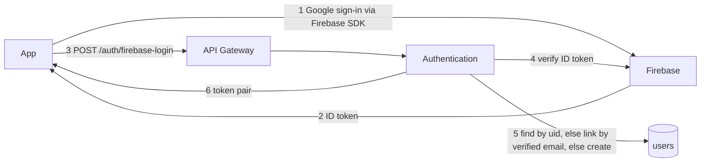

- Linking only happens through an email Firebase marked verified.
- Linking to an existing account discards that account's old password and ends its sessions (stops pre-registration takeover).

## 4. Forgot password (email OTP)

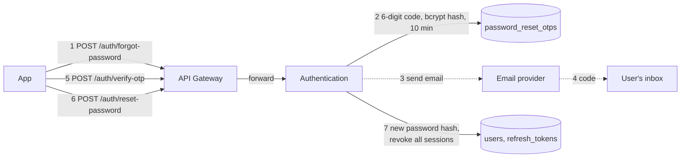

- Always answers "if the email exists, a code was sent" (no probing). A code is stored and emailed only
  when an account has that email: unknown addresses never reach the email provider.
- Limits per address: 1 email / minute, 3 emails / 15 min, 6 emails / day; 5 guesses / 15 min, 15 guesses / day.
- Limit per caller IP: 10 reset requests / hour, known addresses or not. Counted before the per-address
  limits, so a refused flood does not use up a victim's own allowance. All limits answer `429` the same way
  for unknown addresses. The app's "Resend" button waits 60 s to match.
- The email is sent in the background; the HTTP answer does not wait for it.

---

## 5. Profile and public profile

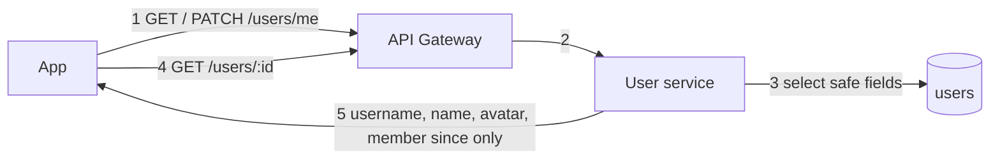

- `username` is the unique handle; `name` is what people see and may be shared. Personal information (`firstName`, `lastName`, `sex`) is only ever returned to its owner.
- A deactivated account is hidden everywhere: no public profile or chat key, no listings on the map or in saved lists, no conversation in other people's chat lists. Signing in again restores it.
- The profile picture is uploaded to our storage (camera or gallery) or synced from the Google account; no other URL is accepted.
- Avatar URL must be on our Supabase storage or a Google profile photo.
- Another user's public profile never includes email, phone or role.

## 6. Post a property (create, photos, pin, boundary)

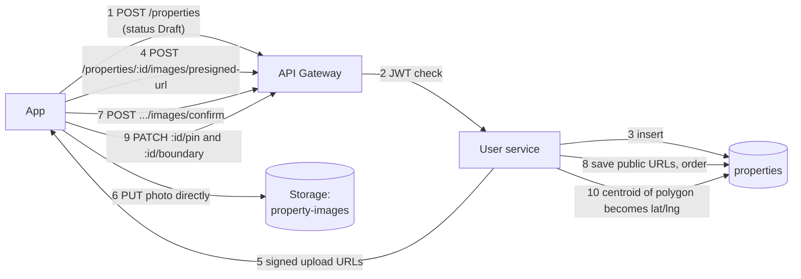

- Ownership is checked on every call (`findOwned`: wrong owner looks like 404).
- Photos never pass through our servers; they go straight to Supabase.
- Confirm only accepts file names this server issued.
- **Thumbnails** (migration 29): confirm also makes a small copy of each new photo (shorter side 600 px, JPEG quality 70, about a sixth of the original) stored next to it as `<name>.thumb.jpg`. Every image the API returns is `{url, thumbnailUrl, ...}`; `thumbnailUrl` is null when the copy could not be made or the photo predates it, and the app then shows `url`. Cards, lists and the map use `thumbnailUrl`; the full-screen gallery uses `url`. Removing a photo deletes its thumbnail too. Old photos are filled by `node property/dist/scripts/backfill-photo-thumbnails.js` (re-runnable).

| Endpoint | Body | Answer | Errors |
| --- | --- | --- | --- |
| `POST /properties` | `title`, `price`, `propertyType` (one of `property-options.ts`), then any of: `listingType` (`Sale`/`Rent`/`To Let`), `titleType`, `description`, `contactPhone`, sizes, the type's details (floors, parking, furnishing, condo, Borey and business fields), `keywords` (codes such as `road_access`, no repeats), `status` | the listing with `images`, `keywords: [{keyword}]` and owner | 400, 401 |
| `PATCH /properties/:id` | any field above except `status`, the type included; left out = unchanged, `null` = cleared (never for title, price, type); `keywords` replaces the whole list | the listing as saved, as above | 400, 401, 404 (missing or someone else's) |

- Every detail is its own column on `properties` (migration 14). A listing keeps only the details of its type (`property-type-fields.ts`): the rest are cleared on create and on every edit, so a listing whose type changed keeps nothing from its old type.
- Keywords live in `property_keywords`, one row per listing and code, checked against the `keywords` table. A new keyword is a new row there plus a label in the app.
- A Borey project's price is its starting (lowest unit) price.
- **Discount** (migration 16): optional `discountType` (`percent` | `amount`, USD) + `discountValue`, both or neither; a percentage must be below 100 and an amount below the price, checked on create and on every edit against the price the listing ends up with (400 otherwise), and by a database CHECK. `price` stays the asking price; the app shows the price less the discount, with the asking price crossed out. The map list carries both fields.
- **Nearby markets, hospitals, schools** (migration 15): when a listing tagged `near_market`, `near_hospital` or `near_school` gets a location (pin or boundary), or an edit changes which of those it carries, the server looks up the nearest 3 of each within 5 km (Google Places Nearby Search, ranked by distance) and their road distance and drive time (Google Routes, one route matrix, typical traffic). This runs after the save answers, so a slow or failing provider never fails the save; failures are logged. Results go to `property_nearby_places` and come back with every full listing as `nearbyPlaces: [{category, rank, name, lat, lng, straightMeters, roadMeters, driveSeconds}]` plus `nearbySearchedAt` (null = never looked up; set with no places = nothing within 5 km). Viewing a listing never calls Google. Needs `GOOGLE_PLACES_API_KEY` with **both** the Places API (New) and the Routes API enabled; without a key nothing is looked up. Cost per lookup: up to 3 Nearby Search (Pro) calls + 1 route matrix of up to 9 elements.

## 7. Publish (listing fee)

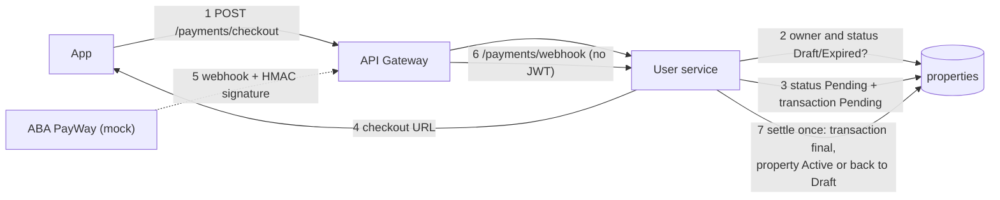

- Fee is a constant (50). Webhook is verified with HMAC-SHA256 and settles a transaction exactly once.
- **The provider is a mock.** Nothing real charges the user yet.
- **Payment can be skipped today** (see section 15, item 1).

## 8. Browse the map and view a listing

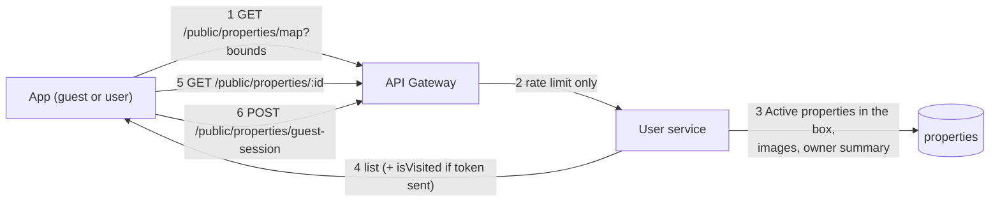

- Optional filters (the pills under the search bar): `propertyType` and `listingType`, exact values from `property-options.ts` (400 otherwise). Served by the `(status, property_type, lat, lng)` and `(status, listing_type, lat, lng)` indexes.
- The list is cached for 30 s per ~1 km grid box and filter, and cleared the moment a published listing in its area changes (versions per ~11 km cell; a map wider than 64 cells uses one version every change counts up); `isVisited` is looked up per user.
- No pagination and no limit on the map query: a wide box returns everything with all images.
- The owner's email and phone, and the listing's own `contactPhone`, go to signed-in callers only (`GuestContactInterceptor` on `/public/properties` and `/public/search`, after `OptionalJwtAuthGuard`). A guest, or a token that is expired or invalid, gets the same answer without them, so the public routes cannot be used to collect contact details. The cached answer is shared; the details are dropped from a copy. The app renews an access token it can see has expired before sending, so a signed-in user is not served the guest answer.

## 8a. Search: places, listings and people

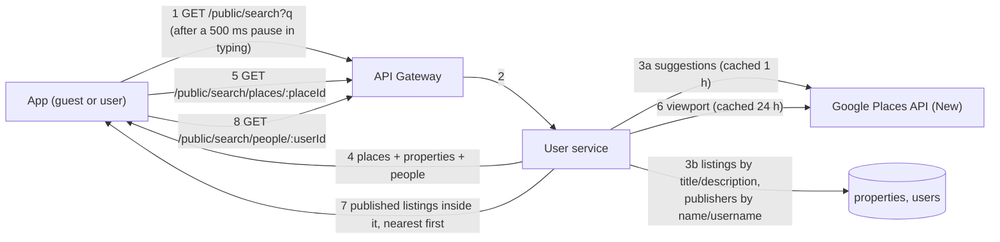

| Endpoint | Query | Answer | Errors |
|---|---|---|---|
| `GET /public/search` | `q` (1-200 chars; matched on its first 80, lowercased), `session`?, `lang`? (`en`/`km`), `lat`?, `lng`? | `{ places: [{placeId, primaryText, secondaryText}], properties: [map listing], people: [{id, name, username, avatarUrl, listingCount}] }`; empty lists for a text under 2 characters | 400, 429 |
| `GET /public/search/places/:placeId` | `session`?, `lang`? | `{ place: {placeId, name, address, center, viewport}, properties: [map listing] }`, at most 100 | 400, 404 unknown place, 429, 503 no key or provider down |
| `GET /public/search/people/:userId` | | `{ person, properties }`, newest first, at most 100 | 400, 404, 429 |

- Public, like the map: a token is optional and only changes how the rate limit counts (per account instead of per address): 120 searches a minute.
- A listing matches when its title or description contains every word of the text, in any order; a person when their name or username does. Only published listings, and only people with at least one, can be found: search is no directory of accounts. A person result never includes email or phone.
- Places come from Google, called by the server so its key (`GOOGLE_PLACES_API_KEY`) is never in the app. The app makes one `session` token per search, so the suggestions and the place picked are billed as one session. Without a key, or when Google fails, search still answers listings and people.
- A place's viewport is grown to at least ~500 m, so a single address still finds the listings around it.
- Listing results have their own cache version: publishing or hiding any listing outdates them at once; one owner's listings are outdated by that owner's changes only. Trigram indexes (migration `11_search_indexes`) keep the `ILIKE '%word%'` queries off full table scans.
- A person result carries `memberSince`. `GET /public/search/people/:userId` is the profile page, opened from search or by tapping the other person in a chat. It answers for any active account (404 if missing or deactivated), but only search finds people, and only publishers. It carries `email` and `phone` only for publishers, whose listings already show them, and only to a signed-in caller; someone who has published nothing keeps them private. Result lists never include contact details, so search cannot be used to collect them in bulk. The page has Follow (does nothing yet), Chat and View on map.

**Saved searches and alerts** (signed-in only; migration 32, `saved_searches` and `saved_search_matches`):

| Endpoint | Body | Answer | Errors |
|---|---|---|---|
| `GET /search/saved` | | `[{id, name, minLat, maxLat, minLng, maxLng, propertyType, listingTypes, minPrice, maxPrice, minSize, maxSize, keywords, alerts, createdAt}]`, newest first | 401 |
| `POST /search/saved` | `name` (1-60, trimmed), the map area, and any of the map filter's fields as in `GET /public/properties/map` (lists as JSON arrays: `listingTypes`, `keywords`), `alerts?` (default true) | the saved search | 400 (unknown type, keyword or listing type; a range upside down), 401, 409 (already 20) |
| `PATCH /search/saved/:id` | `name?`, `alerts?` | the saved search | 400, 401, 404 (not yours) |
| `DELETE /search/saved/:id` | | 204, also when already gone | 401 |

- A listing **goes on the map** when it is live and has a location; `ListingChanges.wentLive` fires on that change, whichever step makes it: created live, published, relisted, paid for, or (the app's way) created live and then given its boundary or pin. Moving it later is not a new listing.
- `SavedSearchMatcher` then finds the alerting searches of other people whose area holds it and whose filter it passes the way the map filter does (asking price before discount; the type's card size, `SIZE_FIELD_BY_TYPE`; every keyword of the search). Each search alerts about a listing once (`saved_search_matches`), so unpublishing and publishing again tells nobody twice. A person gets one push per listing however many of their searches match; the owner is never told.
- The property service asks the notification service (`POST /internal/notifications/saved-search-match`, service token from `property`, at most 500 people a call). This runs after the write answers; a failure is logged.
- The push: `New listing in "<search name>"` with the listing title, Android channel `listing_alerts`, data `{type: saved_search_match, propertyId}`; one per listing (tag `listing:<id>`). Off with the preference `savedSearchAlerts` (migration 32 adds the column).
- Not covered: a listing posted by someone the searcher blocked still alerts them.

**Search history** (signed-in only, token required; migration `12_search_history`):

| Endpoint | Body | Answer | Errors |
|---|---|---|---|
| `GET /search/history` | | `[{id, query, searchedAt}]`, newest first, at most 20, last 14 days only | 401 |
| `POST /search/history` | `{query}` (2-80 chars after trimming) | the entry; the same text again (case and spacing aside) keeps its id and moves to the top | 400, 401, 429 (60 a minute) |
| `DELETE /search/history/:id` | | 204 | 400, 401, 404 (missing or someone else's) |

- The app saves a search when it is finished (a result picked, or the search key pressed), never per keystroke, and loads the list each time the search page opens, so every device shows the same history.
- Entries older than 14 days are never returned, and are deleted (for everyone) whenever someone saves a search; each account keeps at most its 50 newest. Deleting the account deletes its history.

## 9. Save a property (like, favorite, view, contact owner)

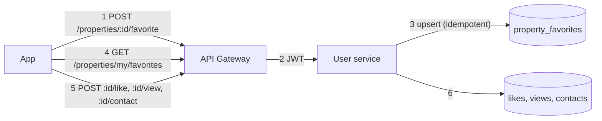

- Like, favorite and view are `INSERT ... ON CONFLICT DO NOTHING`: repeating is harmless.
- Every listing read carries `_count: { favorites, views, contacts }`, counted for the listings read only (`PropertyEngagementCounts`; Prisma's own `_count` grouped the whole tables on every read). A view is one row per person (`property_views`), so `views` is how many people opened it; the owner opening their own listing is not recorded (migration 19 removed earlier ones). The app records a view when a listing is selected on the map or its detail sheet opens. Counts may lag by the public cache (map 30 s, detail 60 s).
- Contact stores a message for the owner in the database. **The owner is not notified** (no push, no email). The app has no contact form: buyers reach owners by Chat or Call Now.
- **Leads** (migration 31, `property_leads`): `POST /properties/:id/lead { channel: call|chat }` (204) when a signed-in buyer taps Call or Chat on a published listing. One row per person, listing and channel, so tapping again counts nothing; the owner's own taps are not counted; limited with contact messages (10 every 10 minutes); 404 for a listing that is not published. `_count.contacts` is the number of people who called or chatted, plus contact-form messages.
- **Insights** `GET /properties/:id/insights` (owner only, 404 for anyone else's): `{ totals: { views, saves, calls, chats }, days: [{ date, views, saves, leads }] }`, the last 14 days in Cambodia time, oldest first, a quiet day as zeros. Each person counts once per kind: a view is someone's first opening, a save one still saved, a lead their first tap per channel. Read through `(property_id, created_at)` indexes on views, favorites and leads.
- Lists can be read a page at a time. Without `limit` each answers the whole list as an array, as before, so older app builds keep working:

| Endpoint | Page |
|---|---|
| `GET /properties/my/favorites?limit=&offset=&sort=` | `{ items, nextOffset }`; `sort`: `saved` (most recently saved first, default), `newest` (listing age), `priceHigh`, `priceLow` (by number) |
| `GET /properties/my/favorites/ids` | The ids of every saved listing: what the heart on each card shows |
| `GET /properties?limit=&offset=` | The user's own listings, newest first: `{ items, nextOffset, countByStatus }`; `countByStatus` covers all of them (the My Properties tabs) |
| `GET /properties/my/in-area?minLat=&maxLat=&minLng=&maxLng=` | The user's own listings (drafts too) inside a map area, newest 500: the map's edit markers |

  `limit` is 1-50 (`offset` at most 10 000).

---

## 9a. Follow people, and the Feed tab

Anyone can follow anyone (migration 26, table `follows`, one row per pair). Only the counts are
shown: nobody can see who follows whom. The user service owns following; the property service
asks it who a user follows (`GET /internal/follows/:userId/following`, service token, cached in
Redis and dropped on every follow/unfollow) and reads the feed itself, so it never touches the
`follows` table.

| Endpoint | Answer | Errors |
|---|---|---|
| `GET /users/:id/follow` | `{ followerCount, followingCount, isFollowing }`; counts leave out deactivated accounts; `isFollowing` is false on your own | 400 (bad id), 401, 404 (missing or deactivated) |
| `PUT /users/:id/follow` | the same, after following; twice changes nothing | 400 (yourself, bad id), 401, 404, 409 (already following 500) |
| `DELETE /users/:id/follow` | the same, after unfollowing; allowed for a deactivated account; twice changes nothing | 400, 401 |
| `GET /feed?limit=&cursor=` | `{ items, nextCursor }`: `Active` listings of followed, not deactivated owners, newest first by feed rank (`publishedAt`, moved older for each newer live listing of the same owner, see below; ties by id); send `nextCursor` back as `cursor`; `limit` 1-50, default 20. Items are card fields only: no description, nearby places, keywords, counts or owner contact; at most 5 photos. Open a listing with `GET /public/properties/:id` | 400 (bad `limit` or a cursor this server did not hand out), 401, 503 (user service down) |

`published_at` (migration 27) is set the first time a listing goes live (created live, published,
or paid for), and again only when it comes back on the market after being Sold or Expired. A
listing taken back to a draft and published again keeps its first date, so unpublishing cannot
push it to the top of the feed (`published-at.ts`). Listings live before the column existed got
their `created_at`. One owner's burst is spread out: a listing is ranked by `published_at` minus
`FEED_OWNER_SPREAD_HOURS` (default 3) for each newer live listing of that owner, so their 2nd newest ranks 3 h
older, the 3rd 12 h older, and mixes in with other people's posts. The cursor carries that rank time, cut to ms.
If the owner publishes again mid-scroll their older listings shift down, so one card may repeat or be skipped.
The feed reads each
followed owner's best listings from the index `(user_id, published_at DESC, id)` and merges
them, so a page costs at most 500 x 21 index rows however many listings those owners have
(measured: 60 agents x 2 500 live listings, 271 ms for one `IN (...) ORDER BY` against 14 ms).
A cursor, not an offset: a listing published while someone scrolls neither repeats nor pushes
one out of the next pages. The app keeps the first page per account on the device, shows it at
once on the next start, and reads the feed again when the tab is shown after 5 minutes.
Deleting an account deletes its follows (foreign keys). Blocking removes follows both ways (9b).

**Pushes about listings** (migration 33; `property/src/alerts`, driven by the listing events of `ListingChanges`):

| Event | Who is told | How often | Preference |
|---|---|---|---|
| A listing goes on the map (see 8a) | Everyone following its owner (`GET /internal/follows/:userId/followers` on the user service) | Once per listing ever (`properties.followers_notified_at`, claimed atomically): publishing again or relisting tells nobody twice, as the feed does not move it up | `followedListings` |
| The price a buyer pays (after discount) on a live listing falls by at least 1% | People who saved it, never the owner | At most one push per listing a day (`price_drop_notified_at`) | `savedListingUpdates` |
| A live listing is marked sold | People who saved it | Each time | `savedListingUpdates` |

- Every drop is marked on the listing (`price_dropped_at`, `previous_price` = what a buyer paid before); a later price at or above `previous_price` takes the mark away. Feed cards (`FEED_CARD_SELECT`) and full listings carry both, and the app shows "Price dropped" with the old price for 14 days.
- Notification routes (service token from `property`, at most 500 people a call): `POST /internal/notifications/followed-listing { propertyId, title, ownerName, recipients }`, `POST /internal/notifications/saved-listing-update { propertyId, title, kind: price_drop|sold, from?, to?, recipients }`. Pushes: "Dara posted a new listing" / "Price dropped: <title>" ("$120,000 → $110,000") / "Sold: <title>", Android channel `listing_alerts`, data `type` `followed_listing`, `price_drop` or `listing_sold` with `propertyId`, one per listing on the phone.
- If the user service cannot answer when a listing goes live, its followers are not told (the claim is already made); the failure is logged.
- The feed still shows live listings only: a sale is a push, not a feed card.

---

## 9b. Block and report

Migration 30: `user_blocks` (one row per pair, like `follows`) and `reports`. Both are owned by the user
service. The chat service asks it whether two people may reach each other
(`GET /internal/blocks/:userId/with/:otherId`, service token from `chat`), so it never reads `user_blocks`.

| Endpoint | Answer | Errors |
|---|---|---|
| `GET /users/:id/block` | `{ isBlocked, canMessage }`: `isBlocked` is whether *you* blocked them; `canMessage` is false when either blocked the other, so the person blocked is not told who did what | 400, 401 |
| `PUT /users/:id/block` | the same, after blocking; twice changes nothing | 400 (yourself), 401, 404 |
| `DELETE /users/:id/block` | the same, after unblocking; twice changes nothing | 400, 401 |
| `GET /users/me/blocks` | `[{ id, name, username, avatarUrl, blockedAt }]`, newest first, at most 500 | 401 |
| `POST /reports` `{ targetType: listing\|user, targetId, reason, details? }` | `201 { id, status: open, createdAt }`; one open report per person and target (partial unique indexes), so reporting again answers the same one | 400 (yourself, bad reason or target type), 401, 404 (the database's foreign key: this service does not read listings), 429 (20 an hour) |
| `GET /reports/admin?status=&limit=&cursor=` | admins only (`AdminGuard`, now in `shared`): `{ items, nextCursor }`, oldest first, `open` by default; a listing is named by `propertyId` only | 401, 403 |
| `PATCH /reports/admin/:id` `{ status: resolved\|dismissed, note? }` | the report, naming its reviewer | 401, 403, 404, 409 (already closed) |

- Blocking deletes the follows between the two in the same transaction, and drops both accounts' cached block
  and following ids. Unblocking does not bring the follows back.
- While either has blocked the other: following is refused (`403`); sending a message is refused on the socket
  as `{ status: error, code: blocked }` and nothing is stored or pushed; a call invite answers `unavailable`,
  as if nobody answered. Earlier messages stay in both conversation lists.
- If the user service cannot answer within 2 s, messages and calls go through and the failure is logged:
  chat keeps working through a user-service outage.
- Reasons: `spam`, `scam`, `misleading`, `inappropriate`, `duplicate`, `unavailable`, `harassment`,
  `impersonation`, `other` (a CHECK in the database and `REPORT_REASONS`). A message is reported as its sender:
  the server cannot read it. `details` is at most 1000 characters.
- A report is deleted with its target (a deleted listing or account needs no review). Closing a report changes
  nothing else; taking a listing down is a separate step. There is no admin screen yet.
- Not covered: presence and last seen are still visible to a blocked person.

---

## 10. Chat: first use (create keys; every account has a chat PIN)

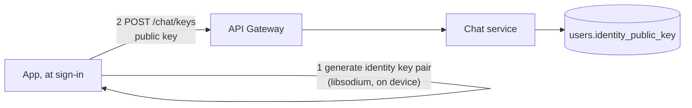

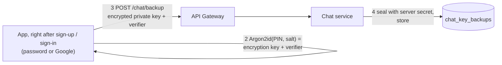

- Messages are always end-to-end encrypted. Keys are made without asking anything as soon as someone signs in, so they can be messaged before they ever open a chat.
- **Every account has a 6-digit chat PIN** (since 2026-10-18; before that it was optional, and for a few days password accounts locked their keys with the account password instead). A signed-in account without one is stopped by a full-screen "Create your chat PIN" step before it can use the app: right after signing up, after any sign-in (email/phone and password, or Google), and at the next app start for older accounts. The only way past it is creating the PIN or signing out. The PIN cannot be turned off.
- Creating the PIN backs up the keys the device holds. A device that does not hold the account's current keys (they were never backed up) makes new ones and swaps the public key and the backup in one step (`POST /chat/keys/reset`, no proof needed while there is no backup); earlier messages cannot be read there.
- A backup still locked with the account password (`chat_key_backups.protected_by = 'password'`, migration 18) is moved to a PIN by the same step: the password is typed once (a device with the keys proves it with `POST /auth/account/password-proof`; one without opens the backup with it), then the PIN replaces it. If the password was reset since and no device here can open the backup, the user can start over with new keys.
- The account password no longer touches chat: signing in, changing or creating it leaves the keys alone. It is only used to prove a forgotten PIN is the owner's (section 14).
- The app asks the server whether a PIN exists once per sign-in. If the server cannot be asked, nobody is blocked; the check runs again at the next start.
- The server enforces it too. Sending a message needs a PIN-locked backup (`403` "Create your chat PIN before sending messages."), so an app build that skips the PIN cannot chat. A backup still locked with the account password does not count until it is moved; one from before PIN tries were counted does. Only a yes is cached (`chat:has-pin:<user>`, 24 h): a PIN cannot be removed (there is no `POST /chat/backup/remove` any more), and new backups are refused unless `protectedBy` is `pin`.
- Keys are still published before the PIN exists (`POST /chat/keys`), so others can start a conversation with a brand-new account; that account replies once its PIN is created.
- With a backup the public key can only be replaced with the PIN or the account password (`POST /chat/keys` answers `409`).
- The private key never leaves the device unencrypted.
- The server stores the key encrypted twice: by the PIN-derived key (device) and by `CHAT_BACKUP_SECRET` (server). The PIN proof is stored only as a keyed hash.

## 11. Chat: send and receive a message

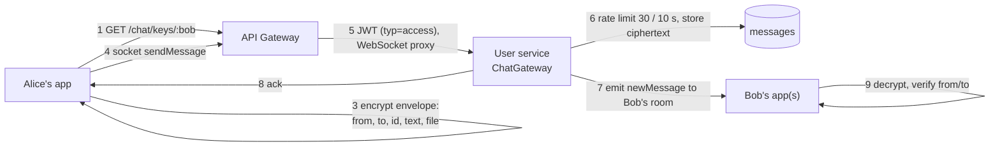

- Server stores `ciphertext + nonce` only. Sender and recipient are **inside** the encrypted envelope, so the server cannot swap or replay messages as someone else's.
- The client picks the message `id`, so a retry never creates a duplicate.
- Each user has a Socket.IO room: every device of the recipient and the sender's other devices receive it.
- If the recipient is offline the message waits in the table; they get it when they open the chat. **There is no push notification.**
- History: `GET /chat/messages/:id?before=` pages of 50. Conversation list: one SQL query (`DISTINCT ON`) plus unread counts.

## 12. Chat: presence (online, last seen)

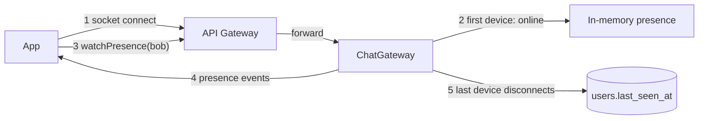

- Presence is asked across all instances through Redis (falls back to this instance if Redis does not answer within a second).
- Any signed-in user can watch any other user's presence.

## 13. Chat: send a picture

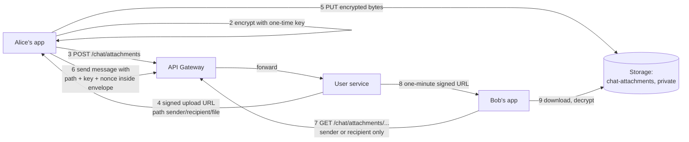

- The file key travels only inside the encrypted message.
- 25 MB limit, 20 upload requests per user per minute.
- Pictures are images only in the UI; other files show as a name.

### Archive and delete a conversation

A conversation is the messages between two people, so each person's own view of it lives in `chat_conversation_states` (migration 17): when they archived it and when they deleted it for themselves.

| Endpoint | What it does |
|---|---|
| `GET /chat/conversations?list=archived` | The archive. Without `list` (or `list=main`): the main list, without archived or deleted conversations. With `limit` (1-100): one page `{ items, nextCursor, unreadTotal }`; pass `cursor=<nextCursor>` for the next. The cursor names the last conversation shown, so one jumping to the top meanwhile is neither repeated nor skipped. `unreadTotal` counts the whole list (the chat tab badge) |
| `POST /chat/conversations/:participantId/archive` / `unarchive` | For the caller only. A newer message (from either side) brings it back to the main list by itself |
| `POST /chat/conversations/:participantId/delete` `{ forEveryone?: boolean }` | Default: for the caller only; messages up to now are hidden from them (history, unread count). A newer message brings the conversation back, starting there. `forEveryone: true`: deletes every message both ways and the pair's attachment files, for both people; cannot be undone |

Each change is announced on the socket as `conversationChanged { participantId, historyCleared }` to the caller's devices, and for `forEveryone` to the other person's devices too, so lists and open chats update at once.

### Reply to, edit and delete one message

Migration 22: `messages.reply_to_id` (FK to `messages`, `ON DELETE SET NULL`), `messages.edited_at`, and `chat_hidden_messages (user_id, message_id)` for "delete for me".

| Endpoint / event | What it does |
|---|---|
| socket `sendMessage { ..., replyToId? }` | A reply. Linked only if that message is in the same conversation; otherwise (deleted meanwhile, or another chat) it is stored as an ordinary message. Every message the app receives (ack, `newMessage`, history) carries `replyTo { id, senderId, recipientId, ciphertext, nonce, createdAt, editedAt }` or `null`, and `editedAt` |
| `POST /chat/messages/:messageId/edit` `{ ciphertext, nonce }` | The sender's new text, sealed again on their device, within **1 hour** of sending (checked inside the update). `403` someone else's message or too late, `404` not in the caller's conversations. Returns the stored message |
| `POST /chat/messages/:messageId/delete` `{ forEveryone?, attachmentPath? }` | Default: hidden from the caller only (history, conversation list preview, unread count); either person may do it. `forEveryone`: sender only (`403` otherwise), no time limit; the row is deleted with nothing left in its place, replies to it lose their quote, and `attachmentPath` (`senderId/recipientId/fileId` of that message, `400` otherwise) is removed from storage. `404` once gone |
| socket `messageEdited` | The edited message (no `replyTo`), to both people's devices |
| socket `messageDeleted { messageId, participantId }` | To the caller's devices, and for `forEveryone` to the other person's too. `participantId` is the other person as seen by the receiver |

- Edit and delete share a limit of 60 per user per minute.
- The server still never reads text: the reply link is also sealed inside the message (`re`), and the app shows a quote only when the server's `replyTo.id` matches it, so the server can drop a quote but never swap one.
- A quoted message the reader deleted for themselves, or from before they cleared the chat, comes back as `replyTo: null`.
- Not covered: a push already shown on a phone stays there after the message is deleted or edited.

## 14. Chat key recovery: new phone, change PIN, forgot PIN

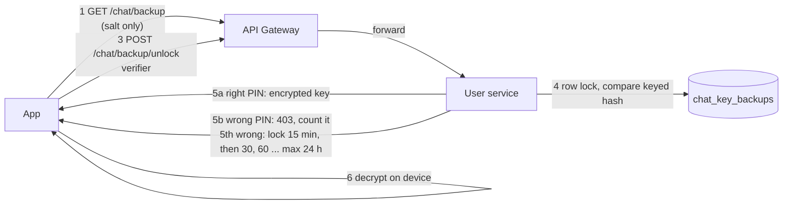

| Situation | What happens |
|---|---|
| New phone, knows PIN | Opening a chat asks for the PIN in a dialog that stays open: steps above, keys restored, old history readable |
| Wrong PIN | The dialog stays open and shows the tries left (`403 { attemptsLeft }`); the field shakes and clears |
| 5th wrong PIN | The dialog shows a lock icon and counts down the wait (`429 { retryAfterSeconds }`: 15 min, then 30, 60 ... max 24 h). Closed, the chat screen says "Too many wrong PINs" |
| No connection while checking | The dialog keeps the PIN and says the check failed; Unlock tries the same PIN again |
| Password reset by email code | Nothing changes for chat: the PIN still opens the backup |
| Change PIN | Unlock with the old PIN, re-encrypt, save again. History stays readable |
| **Forgot PIN** | Confirm with the account password (a Google-only account creates one first), then choose a new PIN. A device that still has the keys keeps the history; otherwise new keys are made and old messages become unreadable |
| Someone guesses | Locked after 5 wrong tries; count is stored in the database so restarts do not reset it |
| Old-format backup | Returned whole once, opened with the PIN, then re-saved in the protected format |

Safety code: both people can compare a number derived from both public keys to detect a swapped key.

---

## 14a. Chat: voice messages

A voice message is a chat file (section 13) with two extra fields inside the encrypted envelope: `voice: { ms, wave }`, its length and 40 loudness bars (0-31). The server sees an ordinary encrypted file and stores nothing new.

- Recorded as AAC (`audio/mp4`, about 6 KB/s) where possible; a browser that cannot record AAC uses Opus or WAV. 0.7 s minimum, 5 min maximum.
- Played from memory (just_audio `StreamAudioSource`): the decrypted audio is never written to the phone. On Android the player reaches it through a local proxy, so the network security config allows plain HTTP to `127.0.0.1` and `localhost` only.
- An older app shows a voice message as a file name.

## 14b. Push notifications (notification service, :4006)

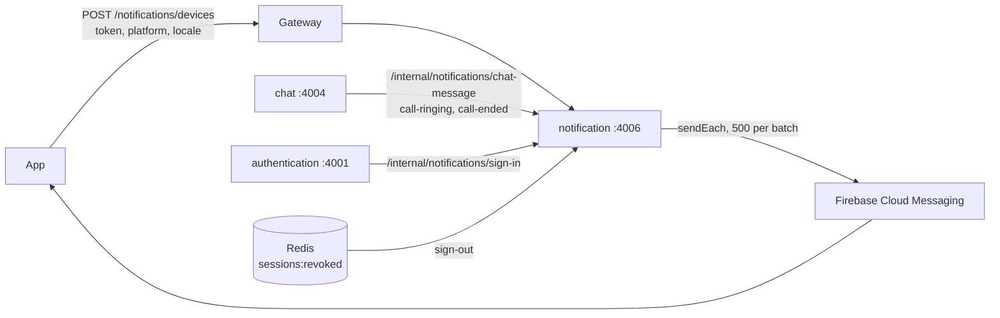

| Kind | Sent when | Shows | Can be turned off |
|---|---|---|---|
| `chat_message` | A new message is stored (not a retried one) | iOS and web: sender name + "New message". Android: a data-only push carrying the sealed message (`ciphertext`, `nonce`, `recipientId`, sender, message id; under 3000 characters, else the generic one), which the app opens with the keys on the phone and shows as a notification with the text. The server and Google only ever carry what is stored: ciphertext | yes (`chatMessages`) |
| `security_sign_in` | An account already in use signs in on another device | "New sign-in to your account": device name and platform; not sent to the new device | no |
| `promotion` | An admin sends one | Title, body (Khmer when written in Khmer), optional picture; opens a listing or an HTTPS page | yes (`promotions`) |
| `call_incoming` / `call_ended` | A call rings / stops ringing | Android: silent and urgent, the app rings full screen. iOS and web: "X is calling" / "Missed call" | no |

API (all need a signed-in user):

| Endpoint | What it does |
|---|---|
| `POST /notifications/devices` `{ token, platform: android\|ios\|web, locale?: en\|km }` | `204`. A token belongs to one account and session; signing in as someone else moves it. At most 20 devices per account, oldest dropped |
| `POST /notifications/devices/remove` `{ token }` | `204`. The app calls it before signing out; only the owner's own device is removed |
| `GET /notifications/preferences` | `{ chatMessages, promotions, savedSearchAlerts, followedListings, savedListingUpdates }`, all `true` until changed |
| `PATCH /notifications/preferences` `{ chatMessages?, promotions?, savedSearchAlerts?, followedListings?, savedListingUpdates? }` | Returns the saved preferences |
| `POST /notifications/promotions` `{ id?, title (≤65), body (≤240), titleKm?, bodyKm?, propertyId?, url? (https), imageUrl? (https) }` | Admins only (`users.role = 'admin'`, read from the database). `202` with its status; sent in the background to every device whose owner allows promotions. Repeating a request with the same `id` sends it once |
| `GET /notifications/promotions/:id` | Admins only: `status` (queued, sending, sent, failed) and counts |

- A device signed out from elsewhere is removed the moment authentication publishes the sign-out on Redis. A token Firebase reports as gone is removed after the send.
- Without `FIREBASE_SERVICE_ACCOUNT_JSON` the service runs but sends nothing (logged once).
- Tables (migration 20): `push_devices`, `notification_preferences`, `promotions`.

## 14c. Voice calls

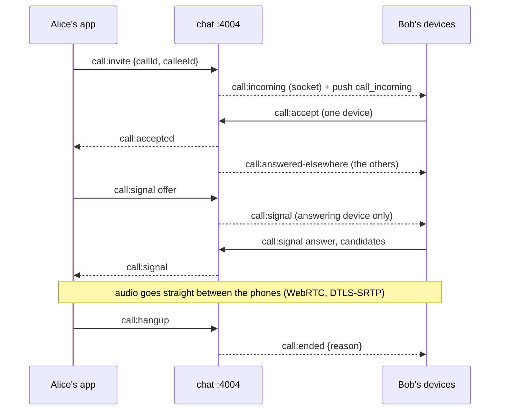

- Signalling rides the chat socket (`/chat` namespace, same sign-in check). The server only introduces the two phones; it never carries audio.
- One call per person: a second caller gets `busy`. Live calls are in Redis (`call:*`), so any instance can answer; every call is recorded in `call_logs` (migration 21): who, when answered, how it ended (`ended`, `declined`, `missed`, `cancelled`, `disconnected`).
- Ringing stops after 45 s (`missed`). A caller giving up is `cancelled`; both are a missed call for the callee. A dropped connection ends an active call (`disconnected`).
- Signals are passed only between the two connections bound to the call; anyone else gets `gone`.
- `GET /chat/calls/ice-servers`: STUN plus a TURN relay, which most calls between two mobile networks need. With `CLOUDFLARE_TURN_KEY_ID` and `CLOUDFLARE_TURN_API_TOKEN` set, each request asks Cloudflare TURN for 6 h credentials (its STUN and TURN servers are returned as is); if Cloudflare fails or times out (4 s), the call falls back to the env servers and the failure is logged. Env servers: Google's public STUN, plus `TURN_URLS` and `TURN_SECRET` (coturn `static-auth-secret`, TURN REST scheme) when set.
- `GET /chat/calls/history?with=<userId>&limit=<1-100, default 50>`: the finished calls with one person, oldest first, for the chat to show among the messages (`id`, `callerId`, `createdAt`, `answeredAt` (null when nobody answered), `endedAt`, `endReason`). Read from `call_logs`, so it is not encrypted and needs no migration. "Delete for me" hides calls from before it, like messages; "delete for everyone" also deletes the calls between the two people.
- Android rings full screen from a silent push when the app is closed. Accept opens the app (after unlocking) and answers; Decline only silences that phone, and the caller hears "no answer" when the ring times out. iOS shows an ordinary notification (no CallKit yet).

## 15. Is this ready for the market? Findings, most important first

These come from reading the code, not from load testing.

### Must fix before launch

| # | Finding | Why it matters | Fix |
|---|---|---|---|
| 1 | **Listing fee can be skipped.** `POST /properties` accepts `status: "Active"`, and `PATCH /properties/:id/publish` sets Active from Draft with no payment | Paid feature is free; anyone can publish | Ignore `status` on create; make `publish` only reachable through a settled payment (or remove it) |
| 2 | **Payment is a mock** | No revenue; flow around it is untested against a real provider | Integrate ABA PayWay (or other) behind the existing `PaymentProvider` |
| 3 | ~~**Owner email and phone returned to anyone** on map and detail, even signed out~~ **Done (2026-10-24):** signed-in callers only (section 8) | Scraping of every seller's contact details | |
| 4 | **Database password in public git history**, and shared by dev and production | Full database access | Rotate; create a separate staging database |
| 5 | **Single container runs everything** | One crash or deploy is a full outage; cannot scale one service | Split services, or at least run 2 replicas once state is moved out (see below) |
| 6 | **No push notifications** | A user does not know a message or contact arrived unless the app is open | Add FCM; notify on new chat message and new contact |

### Fix before real traffic

| # | Finding | Fix |
|---|---|---|
| 7 | Map and favorites queries have no limit or pagination, and return all images | Cap results, return one thumbnail, paginate |
| 8 | ~~Rate limits, login attempts, presence and socket rooms live in process memory~~ **Done:** all in Redis, tested with two instances | Remaining: move Redis out of the container (set `REDIS_URL`) before the second instance |
| 9 | ~~Redis is deployed and used for nothing~~ **Done:** map, listing page, chat keys and public profile are cached with immediate invalidation | Watch the hit rate before caching more |
| 10 | Two ways of reaching the same database: Supabase client in auth, Prisma in user | Pick one (Prisma); simpler to test and migrate |
| 11 | Schema is applied by hand; `_prisma_migrations` only knows `0_init` | Baseline the migration table, run `prisma migrate deploy` in the pipeline |
| 12 | Email and phone are never verified at registration | Verify email with a code, like password reset |
| 13 | Access token stays valid up to 15 minutes after logout | Acceptable; shorten if it worries you |
| 14 | `/health` on the hosted gateway answered 500 / timeout while other routes worked | Investigate before relying on it for uptime checks |
| 15 | Old messages and attachments are never deleted; expired OTP and revoked token rows stay | Retention policy and a cleanup job |
| 16 | No monitoring, error tracking or alerting | Add Sentry (app and backend) and an uptime check |
| 17 | Hosted dependency advisories: 9 left, all need major upgrades and none look reachable | Review with each framework upgrade |

### Product decisions (not bugs)

- Anyone signed in can see anyone's online status and public profile.
- A user with neither name nor username is shown to chat partners by email or phone.
- Forgetting the chat PIN loses history forever (the price of end-to-end encryption). Consider telling users clearly at PIN creation.
- A forgotten chat PIN is recovered with the account password (a Google account creates one first). On a device that still has the keys only the PIN changes; on any other device the keys are reset and earlier history is lost. Whoever knows the account password can therefore reset the chat keys; the other person in each chat is warned that the key changed.
- Deleting an account deletes everything: its files in storage, its payment records, and its messages in other people's conversations with it.
- The one-day rule covers everything that takes the account away from its other devices: signing them out, changing the password, deactivating and deleting. A legitimate owner on a brand-new device therefore waits a day for those too, or uses an older device, or resets the password by email. Recovering a forgotten chat PIN with the password is not under the rule.
- Only one contact path to an owner (chat vs contact form): decide which is the product's main one.

### Not covered

iOS build and settings, Railway and Supabase dashboard configuration, load and latency testing, Google Maps key restrictions, backups and disaster recovery of the database.
